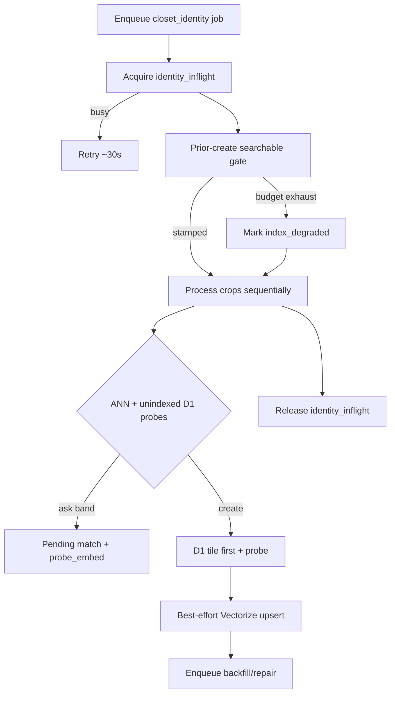

# Outfit identity analysis flow

How an uploaded outfit photo becomes closet tiles, pending matches, and Vectorize vectors.

**Entry:** classification tags outfit images → `CLOSET_IDENTITY_QUEUE` (`kind: closet_identity`).  
**Core:** `OutfitIdentityService.process` / `resolveMatch` in `src/services/identity/outfitIdentity.svc.ts` (writer in `write/`).  
**Repair:** `closet_vector_repair` + hourly `closet_vector_backfill` scan.  
**No Durable Object** — one writer per user via queue + `identity_inflight`.

## Statuses

Closet indexing: `committed` → `indexing` → `indexed` | `index_degraded`  
Match lifecycle: `pending` → claimed (CAS reserved) → done (`same` / `new`)

## Happy path (queue)

## Resolve HTTP

`POST .../resolve` stays off the writer lock and does not return `IdentityBusyError`.

- **same:** CAS + link wear  
- **new:** CAS + D1 create + enqueue index (probe cache; Replicate only if probe missing/stale)  
- Same decision again → 200; opposite → 409

## Degraded window

If Vectorize lags past the searchable-gate budget, tiles become `index_degraded` and the next outfit still runs. Local scoring against recent unindexed/degraded probes (`listRecentUnindexedProbes`) **and** pending-ask probes (`listRecentPendingMatchProbes`) prefers **ask** over silent duplicate creates. Pending asks store `probe_embed` but no closet tile; later outfits still score those crops (neighbor id = the pending match’s candidate tile) so mid-cycle rewear is not starved.
