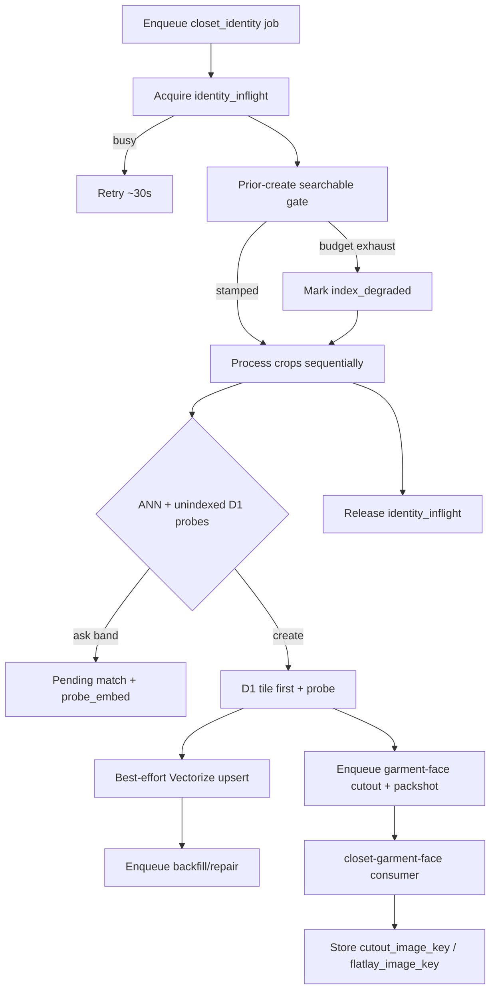

# Outfit identity analysis flow

How an uploaded outfit photo becomes closet tiles, pending matches, Vectorize vectors, and (optionally) display faces.

**Entry:** classification tags outfit images → `CLOSET_IDENTITY_QUEUE` (`kind: closet_identity`).  
**Core:** `OutfitIdentityService.process` / `resolveMatch` in `src/services/identity/outfitIdentity.svc.ts` (writer in `write/`).  
**Repair:** `closet_vector_repair` + hourly `closet_vector_backfill` scan.  
**Faces:** `CLOSET_GARMENT_FACE_QUEUE` (`closet-garment-face`) via `GarmentFaceService` — cutout + packshot, flag-gated.  
**No Durable Object** — one writer per user via queue + `identity_inflight`.

The Flutter app **never** calls `POST /outfits/extract`. Production identity is entirely **async** after style-analysis classification (`closet-browse` + outfit tags). Admin/eval may run the same `process()` in-request.

## Statuses

Closet indexing: `committed` → `indexing` → `indexed` | `index_degraded`  
Match lifecycle: `pending` → claimed (CAS reserved) → done (`same` / `new`)  
Face source (read preference): `flatlay` > `cutout` > `crop`

## Happy path (queue)

Ask stays pending until the user resolves — **no** garment-face jobs while `pending`.

## Resolve HTTP

`POST .../resolve` stays off the writer lock and does not return `IdentityBusyError`.

- **same:** CAS + link wear + enqueue packshot (skip if `flatlay_image_key` already set; fresh claim only)  
- **new:** CAS + D1 create + enqueue index + enqueue packshot (fresh claim only)  
- Same decision again → 200; opposite → 409 (conflicting decision on the same match)

## Garment faces (display)

Identity / Vectorize **always** use real padded crops. Cutout and packshot are presentation only.

| Trigger | Cutout (`GARMENT_FACE_CUTOUT_ENABLED`) | Packshot (`GARMENT_FACE_PACKSHOT_ENABLED`) |
|---------|----------------------------------------|--------------------------------------------|
| Silent **create** (new tile on queue) | Enqueue after `process` | After cutout settles when both on (`followWithPackshot`); else enqueue alone |
| Ask → **new** | If packshot asked and no cutout yet → cutout first | Enqueue on fresh claim (or deferred behind cutout) |
| Ask → **same** | Same deferral when cutout missing | Enqueue on fresh claim (skip if flatlay exists) |
| Ask **pending** | No | No |
| Browse / list | No generation | No generation |

- Queue: `CLOSET_GARMENT_FACE_QUEUE` — jobs `type: cutout | packshot` (`src/services/closet_face/garmentFace.svc.ts`).  
- Cutout: gated SAM + BiRefNet (stricter thresholds for **footwear**); reject → keep crop face.  
- Packshot: Nano Banana flat-lay; prefers stored cutout when present, else **padded crop** (never the full outfit photo).  
- **Display trust:** footwear generative packshot only after a high-confidence cutout; otherwise no `flatlay_image_key` (omit from packshot-only browse). Apparel may packshot from padded crop.  
- List/detail: `isolated_image_url` prefers flatlay > cutout > crop; expose `crop_image_url` + `face_source`. When `GARMENT_FACE_PACKSHOT_ENABLED`, `GET /closet/items` returns only packshot-ready tiles (`flatlay_image_key` set).  
- Judge (eval only): `GET /closet/eval/faces?userId=<EVAL_USER_ID>&admin_key=…` — crop | stored cutout | stored packshot gallery (`&format=json` for tooling). Eval UI **Faces** tab proxies via `/api/closet-faces`.  
- Quality plan: [`.cursor/plans/closet_garment_face_quality_b7e4c901.plan.md`](../.cursor/plans/closet_garment_face_quality_b7e4c901.plan.md).

## Sync vs queue boundaries

| Work | Where | Notes |
|------|--------|--------|
| Presigned upload | Sync HTTP | No identity |
| Classify + enqueue | `waitUntil` after session/message | Outfit tags + PostHog `closet-browse` |
| Claude extract + Florence boxes | Inside `process()` on **queue consumer** | Same code as admin sync extract |
| `identity_inflight` lock | Inside `process()` | Busy → queue retry ~30s (5 attempts) |
| Searchable gate | Inside `process()` | Then `index_degraded` + local probes |
| Embed → Vectorize → policy | Sync in identity job | Ask = pending match; create = D1 tile |
| Cutout / packshot | Separate `closet-garment-face` queue | After create / resolve; flag-gated; never pending ask |
| Progress / catalog realtime | Identity queue path | HTTP extract does **not** broadcast catalog |
| Resolve same/new | Sync HTTP, **no** writer lock | May enqueue packshot |
| Admin `POST /outfits/extract` | Full `process()` **in-request** | Eval/smoke; 409 on busy; enqueues cutout+packshot for creates (same helper as queue) |

## Writer busy (409 vs queue retry)

| Path | Busy behavior |
|------|----------------|
| `CLOSET_IDENTITY_QUEUE` | `IdentityBusyError` → retry ~30s; give up after 5 attempts |
| `POST /outfits/extract` (admin/eval) | **409** with busy message — client must retry; not used by app capture |
| `POST .../resolve` | Never busy — stays off `identity_inflight` |
| `CLOSET_GARMENT_FACE_QUEUE` | Own consumer retries; does not hold `identity_inflight` |

## Degraded window

If Vectorize lags past the searchable-gate budget, tiles become `index_degraded` and the next outfit still runs. Local scoring against recent unindexed/degraded probes (`listRecentUnindexedProbes`) **and** pending-ask probes (`listRecentPendingMatchProbes`) prefers **ask** over silent duplicate creates — including when the ANN query itself throws. Pending asks store `probe_embed` but no closet tile; later outfits still score those crops (neighbor id = the pending match’s candidate tile) so mid-cycle rewear is not starved.

CF Images orient/crop/resize retries once on transient failures (5xx, 429, error **1031**, network timeouts). Per-item embed failure still fails that item only; the rest of the outfit continues.
